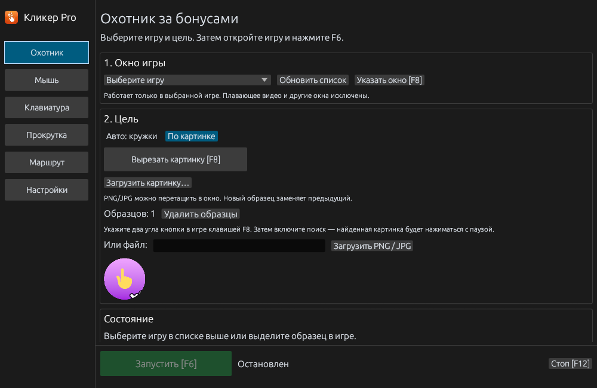

# ClickerPro

Автокликер для Windows: мышь, клавиатура, маршруты и поиск игровых кнопок по изображению. Основная версия написана на Rust с интерфейсом egui.

[](https://github.com/kabachok-hub/ClickerPro/releases/latest)


**[Скачать ClickerPro.exe](https://github.com/kabachok-hub/ClickerPro/releases/latest/download/ClickerPro.exe)** · [Все релизы](https://github.com/kabachok-hub/ClickerPro/releases) · [Что изменилось](CHANGELOG.md) · [Решение проблем](docs/TROUBLESHOOTING.md)



## Быстрый запуск

1. Скачайте `ClickerPro.exe` из [последнего релиза](https://github.com/kabachok-hub/ClickerPro/releases/latest). Установка Python или Rust для готового EXE не требуется.
2. В разделе **Охотник** выберите окно игры.
3. Выберите способ поиска и переключитесь в игру.
4. **F6** — запуск и остановка. **F12** — экстренная остановка.

Программа работает с видимым выбранным окном. При переключении в другую программу поиск приостанавливается.

## Два способа поиска

| Режим | Когда использовать | Настройка |
| --- | --- | --- |
| **По картинке** | Нужна конкретная кнопка, значок или бонус | Вырежьте образец по F8 или загрузите PNG/JPG |
| **Авто: кружки** | Всплывают круглые бонусы со светлым значком и тёмной обводкой | Выберите игру и включите авто |

### По картинке

1. Нажмите **Вырезать картинку [F8]**.
2. В игре наведите курсор на один угол нужной кнопки и нажмите **F8**, затем повторите на противоположном углу.
3. Проверьте миниатюру. Для файла используйте **Загрузить картинку…** или перетащите PNG/JPG в окно.
4. Нажмите **Проверить без клика** и за три секунды переключитесь в игру. Кликер покажет результат без нажатий.
5. Если образец найден, включите поиск через **F6**.

Поиск учитывает прозрачность PNG. Для распознанного круглого образца фон в углах выделения исключается из сравнения. Последний образец восстанавливается при следующем запуске. Новый образец заменяет предыдущий.

### Авто: кружки

Проверяются форма, тёмная круглая обводка и контрастный белый или жёлтый значок внутри. Простого совпадения цвета недостаточно. По умолчанию исключены боковые меню, верхняя панель и нижние счётчики.

Настройка **Не нажимать на меню и счётчики по краям экрана** управляет этим исключением. Если бонус появляется у края или выглядит иначе, используйте поиск по картинке либо ограничьте область вручную в дополнительных настройках.

Авто использует визуальные признаки, а не понимание назначения кнопки. Для определённой цели предпочтителен образец. Поиск по картинке подтверждён пользователем; последнее исправление авто проверено на игровых кадрах и тестами, но ещё требует проверки в живой игре.

## Остальные возможности

- **Мышь:** одиночные и повторные клики, удержание, CPS или интервал, фиксированная точка.
- **Клавиатура:** повторение и удержание выбранной клавиши.
- **Прокрутка:** вертикальное и горизонтальное колесо.
- **Маршрут:** последовательность координат с задержками.
- **Настройки:** переназначение горячих клавиш, поведение окна и ограничения сессии.

Подробные параметры охотника и последний кадр свёрнуты под основными действиями.

## Сборка из исходников

Нужны Windows x64 и установленный Rust toolchain:

```powershell
cargo run --release --locked --manifest-path rust_clicker/Cargo.toml
```

Или запустите `Запустить_из_исходников.bat`. Проверка и сборка одной командой:

```powershell
powershell -File scripts/verify.ps1
```

Скрипт проверяет ошибки Cargo, запускает тесты без реальных нажатий и собирает EXE. [Инструкция для разработки](docs/DEVELOPMENT.md).

## Структура проекта

| Путь | Назначение |
| --- | --- |
| `rust_clicker/` | Основная версия приложения |
| `tests/fixtures/` | Игровые кадры для проверки ложных срабатываний |
| `docs/` | Инструкции и снимок интерфейса |
| `scripts/` | Проверка и сборка |
| `py_clicker/` | Предыдущая Python-версия AutoHunter |
| `src/`, `main.py`, `profiles/` | Предыдущая универсальная Python-версия |

Python-реализации сохранены для истории. Актуальный релиз — Rust-программа `ClickerPro.exe`.

## Ограничения и диагностика

Качество распознавания зависит от размера, анимации и внешнего вида цели. Захват и ввод могут ограничиваться самой игрой. Собственного драйвера и гарантии обхода защиты нет. Если игра запущена от администратора, кликеру могут понадобиться такие же права.

Журнал: `%LOCALAPPDATA%\ClickerPro\hunter.log`. Последний образец: `%LOCALAPPDATA%\ClickerPro\last-template.png`. Эти файлы сохраняются локально.

При проблеме приложите описание режима, снимок без цели и снимок с целью. Перед публикацией журнала проверьте названия окон и другие личные сведения. [Создать issue](https://github.com/kabachok-hub/ClickerPro/issues/new).
